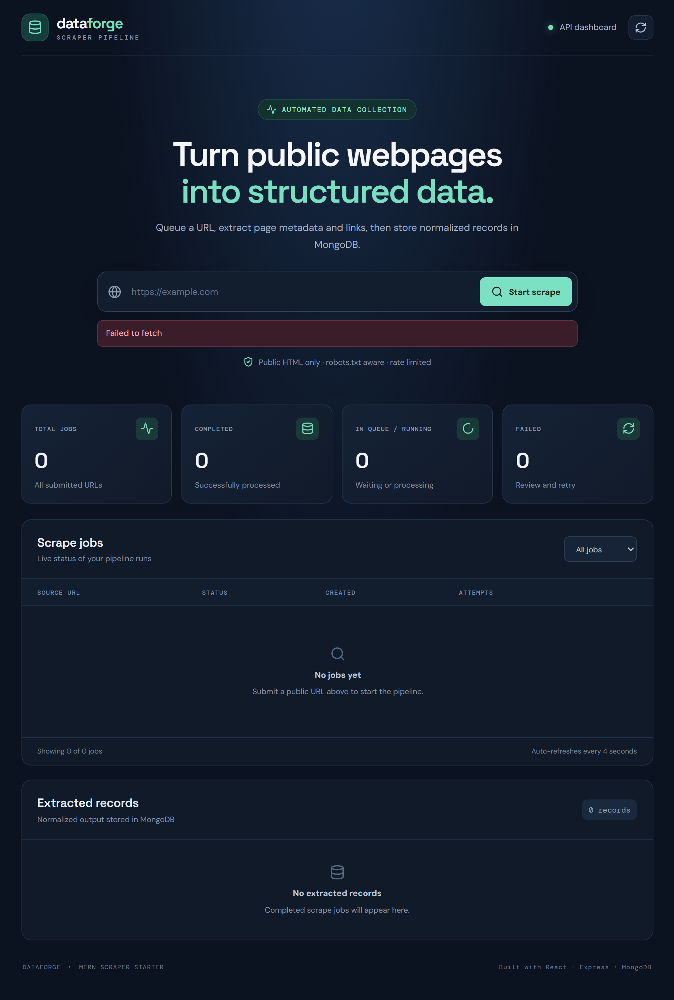

# 🚀 Web Scraper & Data Pipeline

<p align="center">
  A full-stack MERN application that scrapes public webpages, extracts structured data, and stores normalized records in MongoDB.
</p>

<p align="center">
  
  
  
  
  
  
  
</p>

## 📸 Screenshots

<!-- Replace these paths with screenshots saved in your repository. -->

### Dashboard



## ✨ Features

- **Web Scraping:** Fetches public HTML webpages using Axios and Cheerio.
- **Data Extraction:** Extracts page titles, meta descriptions, canonical URLs, headings, links, and text snippets.
- **Data Normalization:** Cleans extracted text, deduplicates links, and generates SHA-256 content hashes.
- **Job Queue:** Processes scrape jobs with queued, running, completed, and failed statuses.
- **MongoDB Integration:** Stores scrape jobs and extracted records using Mongoose.
- **Interactive Dashboard:** Submit URLs and monitor jobs through a React interface.
- **Job Filtering:** Filter jobs by status and inspect processing results.
- **Retry Support:** Retry completed or failed jobs from the dashboard.
- **Live Updates:** Automatically refreshes dashboard data every four seconds.
- **Scraping Safeguards:** Supports robots.txt checks, request timeouts, response-size limits, and basic local/private network blocking.

## 🛠️ Tech Stack

| Technology | Purpose |
|---|---|
| React.js | Frontend user interface |
| Vite | Frontend development server and build tool |
| Node.js | JavaScript runtime |
| Express.js | REST API and backend routing |
| MongoDB | Database for jobs and extracted records |
| Mongoose | MongoDB object modeling |
| Axios | HTTP requests |
| Cheerio | HTML parsing and data extraction |
| robots-parser | robots.txt policy checks |
| Lucide React | Dashboard icons |

## 🏗️ Architecture

```text
                 ┌──────────────────────┐
                 │    React Dashboard   │
                 │       (Vite)         │
                 └──────────┬───────────┘
                            │ HTTP / REST API
                            ▼
                 ┌──────────────────────┐
                 │   Express.js API     │
                 │   Input Validation   │
                 └──────────┬───────────┘
                            │
                            ▼
                 ┌──────────────────────┐
                 │    Job Queue         │
                 │  queued → running    │
                 └──────────┬───────────┘
                            │
                            ▼
                 ┌──────────────────────┐
                 │  Scraper & Parser    │
                 │   Axios + Cheerio    │
                 └──────────┬───────────┘
                            │
                            ▼
                 ┌──────────────────────┐
                 │ Data Normalization   │
                 │ Hashing & Deduplication│
                 └──────────┬───────────┘
                            │
                            ▼
                 ┌──────────────────────┐
                 │      MongoDB         │
                 │ Jobs + Scraped Data  │
                 └──────────────────────┘
```

## 📁 Project Structure

```text
web-scraper-pipeline/
├── client/
│   ├── src/
│   │   ├── App.jsx
│   │   ├── main.jsx
│   │   └── styles.css
│   ├── index.html
│   ├── package.json
│   └── vite.config.js
├── server/
│   ├── src/
│   │   ├── models/
│   │   │   ├── ScrapeJob.js
│   │   │   └── ScrapedRecord.js
│   │   ├── routes/
│   │   │   ├── jobs.js
│   │   │   └── records.js
│   │   ├── services/
│   │   │   ├── jobQueue.js
│   │   │   └── scraper.js
│   │   ├── utils/
│   │   │   └── urlSafety.js
│   │   ├── config.js
│   │   └── index.js
│   └── package.json
├── .env.example
├── .gitignore
├── package.json
└── README.md
```

## ⚙️ Installation & Setup

### Prerequisites

Make sure you have installed:

- [Node.js 20+](https://nodejs.org/)
- [MongoDB Community Server](https://www.mongodb.com/try/download/community)
- [Git](https://git-scm.com/)
- npm (included with Node.js)

### 1. Clone the repository

```bash
git clone https://github.com/YOUR_USERNAME/mern-web-scraper-pipeline.git
cd web-scraper-pipeline
```

### 2. Configure environment variables

Create a `.env` file in the root directory.

**Windows PowerShell:**

```powershell
Copy-Item .env.example .env
```

Configure the environment variables:

```env
PORT=5000
MONGODB_URI=mongodb://127.0.0.1:27017/scraper_pipeline
CLIENT_ORIGIN=http://localhost:5173
SCRAPE_TIMEOUT_MS=15000
SCRAPE_MAX_BYTES=3000000
SCRAPE_DELAY_MS=1200
```

Ensure MongoDB is running before starting the backend.

### 3. Install dependencies

From the root directory, run:

```bash
npm run install:all
```

This installs the root dependencies and the React client and Express server dependencies.

### 4. Start the application

```bash
npm run dev
```

The application will run at:

| Service | URL |
|---|---|
| React Dashboard | http://localhost:5173 |
| Backend API | http://localhost:5000 |
| Health Check | http://localhost:5000/api/health |

## 🚦 How to Use

1. Start the application and open the React dashboard.
2. Enter the URL of a public webpage you are authorized to scrape.
3. Click **Start scrape** to create a job.
4. Monitor the job status in the Scrape Jobs section.
5. Once completed, inspect the extracted record.
6. Review the page metadata, headings, links, and text snippet.
7. Retry a completed or failed job when needed.

## 🔌 REST API Endpoints

Base URL: `http://localhost:5000/api`

| Method | Endpoint | Description |
|---|---|---|
| GET | `/health` | Check API and database status |
| POST | `/jobs` | Create and queue a scrape job |
| GET | `/jobs` | Retrieve recent jobs |
| GET | `/jobs/:id` | Retrieve a specific job |
| POST | `/jobs/:id/retry` | Queue a job for another run |
| GET | `/records` | Retrieve extracted records |

### Create a Scrape Job

**Request**

```http
POST /api/jobs
Content-Type: application/json
```

**Request body**

```json
{
  "url": "https://example.com"
}
```

**Example using cURL**

```bash
curl -X POST http://localhost:5000/api/jobs \
  -H "Content-Type: application/json" \
  -d "{\"url\":\"https://example.com\"}"
```

The API returns HTTP `202 Accepted` when the job is successfully queued.

### Check Job Status

```http
GET /api/jobs
```

Possible job statuses:

- `queued` — waiting for processing
- `running` — currently being scraped
- `completed` — extraction and storage succeeded
- `failed` — processing encountered an error

### Retrieve Extracted Records

```http
GET /api/records?limit=50
```

Records can contain the source URL, page title, description, canonical URL, headings, links, text snippet, content hash, and scrape timestamp.

## 🗄️ Database Models

### ScrapeJob

Stores job execution information:

- Source URL
- Job status
- Attempt count
- Start and completion timestamps
- Error message
- Reference to the extracted record

### ScrapedRecord

Stores extracted webpage data:

- Source and final URLs
- Title and meta description
- Canonical URL
- Headings and links
- Text snippet
- SHA-256 content hash
- Scrape timestamp

## 🔒 Security & Responsible Scraping

This project includes basic safeguards for responsible public-page scraping.

- Restricts input URLs to HTTP and HTTPS.
- Blocks many localhost and private-network destinations.
- Checks robots.txt before fetching pages.
- Applies configurable request timeouts and response-size limits.
- Adds a delay before scraping a page.

**Important:** These safeguards are not a complete production-grade security boundary. Only scrape sites you are authorized to access. Respect site terms, robots.txt directives, rate limits, privacy, and copyright. Do not use the project to bypass authentication, access controls, or anti-bot systems.

## 🚀 Future Improvements

- Redis and BullMQ for persistent job queues
- Scheduled scraping with cron jobs
- Authentication and role-based access control
- Pagination, search, and advanced filters
- CSV and JSON data exports
- Configurable extraction rules
- Scraping analytics and job performance metrics
- Automated tests and CI/CD
- Production deployment and monitoring

## ⚠️ Current Limitations

- The queue runs in memory, so pending jobs can be lost after a server restart.
- The scraper supports HTML pages and does not execute JavaScript in a browser.
- The application does not currently include user authentication.
- Network restrictions need further hardening before public deployment.

## 🤝 Contributing

Contributions, suggestions, and bug reports are welcome.

1. Fork the repository.
2. Create a feature branch.
3. Commit your changes.
4. Open a pull request.

## 📄 License

This project is available under the MIT License. Add a `LICENSE` file to the repository if you choose to distribute it under that license.

## 👨‍💻 Author

**Ajinkya Dhatrak**

GitHub: [ajinkya029](https://github.com/ajinkya029)

---

<p align="center">
  Built with ❤️ using the MERN stack.
</p>
